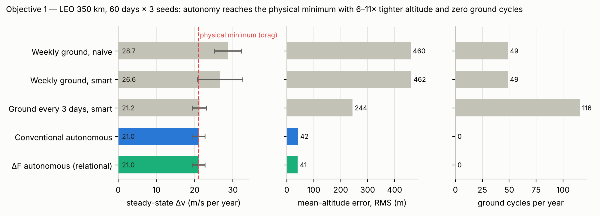
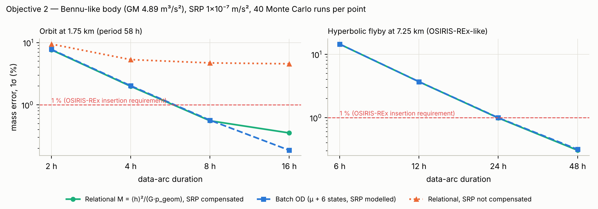
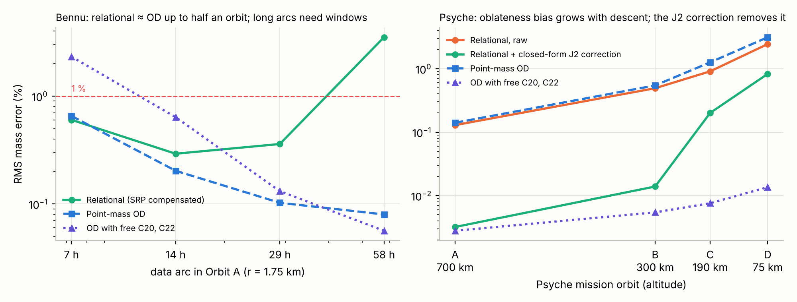
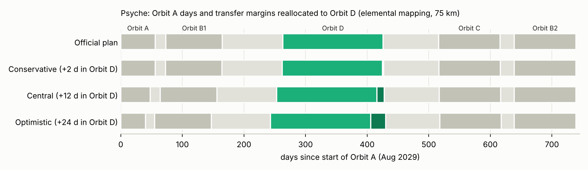
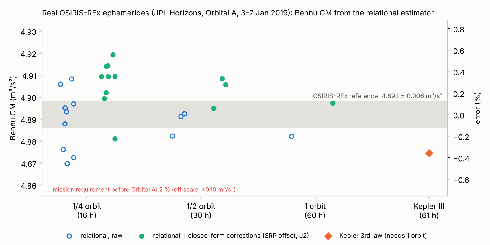
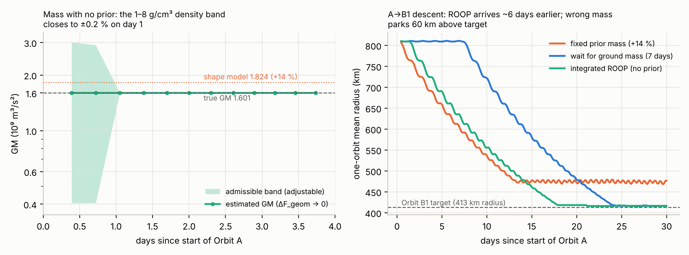
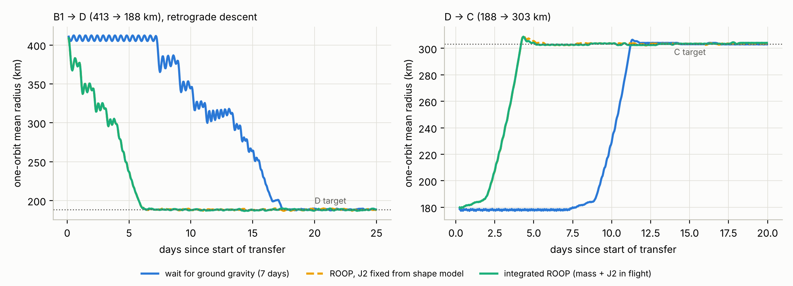

*Code, data and figures: [github.com/Maia-KarlosMarden/roop](https://github.com/Maia-KarlosMarden/roop), under the Apache 2.0 license.*

## Abstract

The Relational Invariance G′r = Gp, with G′ = 3ω²/4πρ and ρ = 3M/4πr³ (Maia, 2026, Section 2.2), is an exact reformulation of Keplerian mechanics. It stands to Kepler–Newton as Lagrangian mechanics stands to Newton: it predicts nothing different, but it shortens certain calculations. This article derives from it ROOP (Relational Orbital Optimization Protocol), a protocol with two closed-form, onboard-capable tools, and tests them against market practice and against real flight data.

**Autonomous orbit control.** The relational command ΔF says whether, how much and where to fire. In LEO at 350 km, with J2, J3, drag under variable solar activity and GNSS noise, it spends 21.0 m/s/yr, the physical minimum imposed by drag. It holds mean altitude to 41 m RMS and eliminates 49 to 116 ground planning cycles per year. Against weekly ground control it saves 21–27 % of Δv (1.3–1.8 kg/yr of hydrazine on 500 kg); against ground control every 3 days, ~1 %. It ties conventional autonomous control while using ~25 % fewer operations per sample.

**Asteroid mass.** The estimator M = ⟨h⟩²/(G·p_geom) is linear and needs neither an initial guess nor propagation.

- **Simulation.** On a Bennu-like body it matches batch orbit determination (OD) down to ~1 %, with 300 to 2,000× less computation. At Psyche, a closed-form J2 correction brings it to 0.001 % in Orbit A. During the A→B1 spiral it delivers GM (< 0.03 %) and J2 (~10 %) on board from day 4, which allows 2 to 24 days to be reallocated to the elemental-mapping orbit. In closed loop and without a prior mass, ROOP uses the same quantity ΔF to correct the mass and to command thrust, and reaches Orbit B1 6 to 7 days earlier than a strategy that waits for the ground mass solution, with the same Δv.
- **Real flight data.** Applied to the reconstructed OSIRIS-REx trajectory at Bennu (JPL Horizons), it gives GM = 4.897 m³/s² from one orbit, against the reference 4.892 ± 0.006 m³/s² (+0.11 %, within 1σ). With 16 h windows the error lies between −0.05 % and +0.30 %, whereas Kepler's 3rd law needs 61 h and is off by −0.36 %.

The reformulation is useful in the Lagrangian sense: it does not change the physics nor beat the physical minimum, but it turns calculations that today depend on osculating elements, propagation or the ground into short, cheap, closed-form onboard computations.

## Contributions

This article claims the contributions below, each with the evidence that supports it.

1. **An operational reading of the Relational Invariance.** The relation G′r = Gp separates orbit size (⟨G′r⟩ against Gp) from shape (the oscillation of K = G′/G along the orbit), and each part becomes an engineering tool (Section 3).
2. **ΔF, a complete relational thrust command.** A single quantity delivers the firing criterion, the pulse size in m/s and the firing point u\* that also corrects eccentricity at no extra Δv. It reaches the physical Δv minimum in simulation and ties the autonomous state of the art with ~25 % fewer operations per sample (Section 4).
3. **Relational mass estimator M = ⟨h⟩²/(G·p_geom).** It combines a purely geometric fit of p with kinematic h. It is linear and closed-form, works for orbits and for hyperbolic flybys, matches batch OD to ~1 % with 300 to 2,000× less computation, and was validated on the real OSIRIS-REx trajectory (Sections 3.2, 5.2 and 5.6).
4. **Closed-form corrections for real perturbations.** The factor μ_ef = μ[1 + 1.5·J2·(R/r)²(1 − 3z²/r²)] removes the oblateness bias (0.001 % in Psyche Orbit A). The factor ⟨(r/ρ)³⟩ removes the orbit offset caused by solar radiation pressure, measured from the data themselves (78 m in Bennu Orbital A) (Sections 5.4 and 5.6).
5. **Joint onboard estimation of GM and J2, including during electric-propulsion spirals.** μ_ef is linear in μ and μ·J2, so estimates at different altitudes form a linear regression. In the Psyche A→B1 spiral, GM stays below 0.03 % and J2 at ~10 % from day 4 (Section 5.5). Integrated with ΔF through the same quantity (ΔF_geom for mass, inside an adjustable admissible band, with no prior information), the loop takes the spacecraft from Psyche Orbit A to B1 6 to 7 days earlier than waiting for the ground mass, with the same Δv, and repeats the ~7-day gain in the B1→D transfers (with a retrograde descent, needed to cross the spin resonances) and D→C (Sections 3.3, 5.7 and 5.8).
6. **Value quantification under explicit assumptions.** Δv, propellant, lifetime and ground cycles against four market strategies (Section 4.3); reallocatable days in the Psyche mission and equivalent mining revenue (Sections 5.3 and 5.5).

**What this article does not claim:** new physics; Δv below the minimum imposed by perturbations; performance superiority over conventional autonomous control; mass accuracy better than a full OD; replacement of the shape model, the high-degree gravity field or radiometric tracking; or economic forecasts. The relation h² = μp and fitting conics to positions are classical; the contribution lies in the combination and in the closed-form corrections above, subject to a prior-art literature review.

## 1. Introduction: what makes a reinterpretation useful

Lagrangian mechanics added no prediction to Newton's. Its value lies in trading force vectors and constraint reactions for a scalar and generalized coordinates, which shortens calculations that are long in Newtonian form. A useful reinterpretation is therefore judged by three criteria: (i) it reproduces the predictions of the original theory exactly; (ii) it leads to shorter, closed-form or more robust calculations for some practical problem; (iii) that gain is measured against the methods already in use.

The relational formulation rewrites Kepler's laws in terms of a local coupling G′ = 3ω²/4πρ and an orbital density ρ = 3M/4πr³. Its central relation, G′r = Gp, equates a quantity measured point by point (ω, r) to a quantity of the orbit's geometry (p). The natural skepticism is that this is merely h² = μp under another name. Section 2 confirms that it is — criterion (i) — and the rest of the article tests criteria (ii) and (iii) on two problems of economic interest:

1. **Autonomous orbit control.** How much Δv, propellant and human supervision does an invariance-based controller save compared with what the market uses today: ground-planned station keeping and conventional autonomous control, as flight-demonstrated on DEMETER (CNES) and PRISMA (DLR)?
2. **Asteroid mass in mining expeditions.** How much campaign time does an invariance-based mass estimator save, and how much is that time worth in extra ore?

All results come from reproducible numerical simulation; code and assumptions are listed at the end. Where the reformulation does not help, that is reported too (Section 6).

## 2. Relational formulation

The coupling G′ is defined from two local quantities: the instantaneous angular velocity ω and the orbital density ρ.

The formulation in this section is that of Maia (2026): the definition G′ ≡ ω²r³/M (Section 2.1, eq. 2), the relational invariant G′r = Gp (Section 2.2, eq. 3) and the Keplerian index K = G′/G = p/r = 1 + e cos θ (Section 2.3, eq. 4), in *The Orbital Coherence Function: A Keplerian Pre-Filter for Ensemble Orbit Determination* ([doi:10.5281/zenodo.20248439](https://doi.org/10.5281/zenodo.20248439)), the sole theoretical basis of this article. As that work notes, G′ is not a new physical constant: its utility is notational, turning a global conservation law into a local quantity. The orbital density ρ below is only an equivalent rewriting of G′. Nothing beyond this is assumed; the tools of Sections 3 to 5 are derived here.

### 2.1 Orbital density

The orbital density is the mass of the central body spread over the sphere whose radius equals the instantaneous orbital radius:

$$\rho = \frac{M}{\tfrac{4}{3}\pi r^{3}} = \frac{3M}{4\pi r^{3}}, \qquad r = R_E + h$$

ρ is a gravitational parametrization, not the atmospheric density that governs drag. It decays as r⁻³: ≈ 4.2 × 10³ kg/m³ at 600 km altitude and ≈ 19 kg/m³ at GEO.

| Regime | Altitude | ρ (kg/m³) |
| --- | --- | --- |
| Low LEO | 200 km | ≈ 5.0 × 10³ |
| LEO | 600 km | ≈ 4.2 × 10³ |
| High LEO | 2,000 km | ≈ 2.4 × 10³ |
| MEO (GNSS) | 20,200 km | ≈ 7.6 × 10¹ |
| GEO | 35,786 km | ≈ 1.9 × 10¹ |

### 2.2 Local gravitational coupling

The local coupling is defined as G′ ≡ ω²r³/M (Maia, 2026, eq. 2). With the orbital density ρ it can be written equivalently as:

$$G' = \frac{3\,\omega^{2}}{4\pi\rho}$$

Substituting ρ returns the definition, which is the third law written with the instantaneous radius:

$$G' = \frac{\omega^{2} r^{3}}{M} \quad\Longleftrightarrow\quad \omega^{2} = \frac{G' M}{r^{3}}$$

In the ρ form, G′ reads as the ratio between local angular dynamics and the mass contained in the orbital sphere. In the Keplerian form, it is the value G would take if the orbit were circular with that instant's radius and angular velocity. The two forms are algebraically identical; the ρ form is the relational reading, the ω²r³/M form is the one that gets implemented.

### 2.3 Relational Invariance

With ω = h/r² (Kepler's second law) and h² = GMp, where p = a(1 − e²) is the semi-latus rectum:

$$G' r = \frac{\omega^{2} r^{4}}{M} = \frac{h^{2}}{M} = G\,a(1-e^{2}) = G\,p$$

The left-hand side is local (it depends on r and ω at the instant); the right-hand side is global (constants of the conic). Dimensionally, G′r has units m⁴ kg⁻¹ s⁻², i.e. specific angular momentum squared per unit central mass.

### 2.4 Keplerian index

The index K = G′/G = p/r = 1 + e cos θ reproduces the polar equation of the conic. Its arithmetic mean over true anomaly is exactly 1, so G is the angular mean of G′ along the orbit. The effective index Kₑ = (r_rms,θ/a)³ = (1 − e²)^¾ uses the angular root-mean-square radius r_rms,θ = √(ab), an exact geometric result.

### 2.5 Reading: reinterpretation, not new physics

The chain above shows that G′r = Gp is equivalent to h² = μp. Every dynamical prediction coincides with Newton–Kepler. What the formulation offers is an explicit relation between a local kinematic measurement (ω, r) and a global geometric measurement (p). The following sections test whether that relation yields anything practical.

## 3. Two tools derived from the invariance

The invariance naturally separates the **size** of the orbit (how far G′r is from Gp) from its **shape** (how G′ oscillates along the orbit). Each separation yields a tool.

### 3.1 ΔF: relational thrust command

At each navigation sample, two dimensionless ratios are formed:

$$Q_i = \frac{G'_i\, r_i}{G\, p_{ref}} = \frac{p_i}{p_{ref}}, \qquad K_i = \frac{G'_i}{G} = \frac{p}{r_i} = 1 + e\cos(u_i-\omega)$$

Over a one-orbit sliding window, the mean of Q gives the size deviation, and a linear fit of K against the argument of latitude u gives the eccentricity vector:

$$\Delta F = -\frac{\bar v}{2}\big(\langle Q\rangle_T - 1\big)\ \ [\mathrm{m/s}], \qquad K_i \approx A + B\cos u_i + C\sin u_i \Rightarrow \vec e = (B/A,\, C/A)$$

The firing rule: fire when ΔF > Δv_min, with a transverse pulse of size ΔF centred on the argument of latitude u\* = atan2(Δe_y, Δe_x), which also drives the eccentricity vector **e** toward its target. When the eccentricity correction exceeds what the drag pulse delivers, a pair of opposite pulses half an orbit apart is added. The one-orbit average removes the short-period J2 oscillation (±6 km in p at 350 km) and GNSS noise.

The computation does not go through Keplerian elements: it uses |r × v|, |r| and u, three running sums and one 3×3 solve per orbit.

### 3.2 Relational mass estimator

Read backwards, the invariance gives the central mass:

$$M = \frac{\langle h \rangle^{2}}{G\, p_{geom}}, \qquad \frac{1}{r_i} \approx A + B\cos\theta_i + C\sin\theta_i \Rightarrow p_{geom} = 1/A$$

p_geom comes from a purely geometric fit of the positions in the orbital plane, which uses neither μ nor time; ⟨h⟩ comes from kinematics. The computation is linear and closed-form and works for elliptical orbits and for hyperbolic flybys. On small bodies, a known solar radiation pressure (SRP) acceleration f is removed to first order before the fit: r → r − f·Δt²/2 and v → v − f·Δt.

### 3.3 Integrated ROOP: the same quantity on both fronts

The mass estimator and the thrust command are two readings of the same relational deviation. Since G′ = ω²r³/M requires a mass, the protocol works with the estimated mass M̂. Comparing the kinematic side with two different right-hand sides gives two signals:

$$\Delta F_{geom} = G'r - G\,p_{geom} = h^{2}\left(\frac{1}{\hat M} - \frac{1}{M}\right), \qquad \Delta F = -\frac{\bar v}{2}\left(\frac{\langle G'r\rangle}{G\,p_{ref}} - 1\right)$$

**ΔF_geom** (kinematics against geometry) is exactly the mass error: it vanishes if and only if M̂ = M. ROOP corrects M̂ until ΔF_geom → 0 within an **adjustable admissible band**:

1. **With no prior information**, the initial band comes from the body's size and plausible densities (1,000 to 8,000 kg/m³). For Psyche, GM from 0.41 to 3.0 × 10⁹ m³/s², a factor of 7.
2. Each 1/4-orbit window gives an estimate ⟨h⟩²/(G·p_geom), corrected for J2. The estimate is clipped to the band, so a spurious window cannot push M̂ out of the physical range.
3. The band is recentred on the median of recent windows, with half-width equal to the larger of 3σ (robust) and 0.2 %, and it never widens.
4. Thrust is released only when the half-width falls below 2 %. This makes the tolerance a mission parameter, adjustable to the accepted risk.

**ΔF** (kinematics against reference) commands thrust with the current M̂. If the mass is wrong, ΔF drives the spacecraft to h² = G·M̂·p_ref, that is, to an orbit with p = p_ref·M̂/M, wrong in the same proportion as the mass. That is why both fronts must run together.

## 4. Objective 1: autonomous orbit control against the market

The ΔF controller spends the physical minimum of Δv and eliminates ground planning; the Δv saving relative to ground control ranges from ~1 % to 27 % depending on cadence and required tolerance.

### 4.1 Scenario and competitors

| Item | Value |
| --- | --- |
| Orbit | 350 km, i = 51.6°; target: reference mean semi-major axis and frozen eccentricity vector (J2/J3, e_f ≈ 8.7 × 10⁻⁴) |
| Forces | two-body + J2 + J3 + drag with stochastic solar activity (log-normal factor, σ = 0.35, 2-day correlation) |
| Satellite and propulsion | 500 kg, C_D A/m = 0.0044 m²/kg, 0.1 N thruster, pulses ≤ 0.1 m/s |
| Navigation | GNSS with 5 m and 5 cm/s per axis (1σ) |
| Duration | 60 days × 3 seeds; annual rates measured in steady state (days 20–60) |

Five strategies, all with the same thruster, the same forces and the same noise:

- **Weekly ground, naive**: weekly cycle with perfect orbit determination, persistence drag forecast and 1-day uplink latency; drag pulse anywhere, eccentricity corrected by separate pairs.
- **Weekly ground, smart**: same, but the drag pulse is placed to also correct eccentricity (good practice).
- **Ground every 3 days, smart**: the same good practice at a higher cadence.
- **Conventional autonomous**: on board, with one-orbit-averaged osculating semi-major axis and eccentricity vector, along the lines of DEMETER and PRISMA.
- **ΔF autonomous**: on board, with the same decision logic as the conventional one; only the sensing changes (relational Q and K).

### 4.2 Results

| Strategy | Steady-state Δv (m/s/yr) | Excess over drag | Mean altitude, RMS | Eccentricity error, RMS | Ground cycles/yr |
| --- | --- | --- | --- | --- | --- |
| Weekly ground, naive | 28.7 ± 3.5 | +36 % | 460 m | 1.0 × 10⁻⁴ | 49 |
| Weekly ground, smart | 26.6 ± 6.0 | +26 % | 462 m | 1.2 × 10⁻⁴ | 49 |
| Ground every 3 days, smart | 21.2 ± 1.8 | +0.9 % | 244 m | 4.3 × 10⁻⁵ | 116 |
| Conventional autonomous | 21.0 ± 1.7 | +0.1 % | 42 m | 5.4 × 10⁻⁶ | 0 |
| **ΔF autonomous** | **21.0 ± 1.7** | **+0.1 %** | **41 m** | **5.5 × 10⁻⁶** | **0** |

*Mean ± standard deviation over 3 seeds of solar activity and noise. Steady-state drag was 21.0 m/s/yr in all cases.*

*Figure 1. Steady-state annual Δv (with drag as the physical minimum), mean-altitude error and ground cycles per year. The two autonomous controllers coincide; ground control approaches the minimum only at a 3-day cadence with 116 cycles per year.*

- **The physical minimum is reached.** Both autonomous controllers spend the Δv that drag imposes, no more and no less. No control law can spend less; the question is how much the others waste.
- **Ground-control waste depends on the requirement.** With a weekly cycle and eccentricity required at 10⁻⁴, ground control spends 26–36 % more, because the drag forecast errs and eccentricity escapes its box between cycles, requiring correction pairs. With a 3-day cycle the waste drops to ~1 %, at the cost of 2.4× more ground cycles.
- **Precision is the robust gain.** At any ground cadence, the autonomous controller holds altitude 6–11× tighter and eccentricity 8–22× more precisely.
- **ΔF ties the conventional controller.** Control performance is the same, and so is measurement noise (88 m in p and in a). The difference is cost: relational sensing took 2.3 µs per sample against 3.0–3.5 µs for the conventional one in the same implementation, ~25 % fewer operations, because it needs neither energy (vis-viva) nor the Laplace vector.

### 4.3 Economics

Conversion of Δv into propellant for a 500 kg satellite (m = m₀[1 − exp(−Δv/I_sp g₀)]):

| Baseline | Δv saved | Hydrazine (I_sp 220 s) | Electric propulsion (I_sp 1500 s) | Lifetime, if propellant-limited | Ground cycles eliminated |
| --- | --- | --- | --- | --- | --- |
| Weekly ground, naive | 7.7 m/s/yr (27 %) | 1.77 kg/yr | 0.26 kg/yr | +37 % | 49/yr |
| Weekly ground, smart | 5.6 m/s/yr (21 %) | 1.28 kg/yr | 0.19 kg/yr | +27 % | 49/yr |
| Ground every 3 days, smart | 0.24 m/s/yr (1 %) | 0.06 kg/yr | 0.01 kg/yr | +1 % | 116/yr |

At scale, a constellation of 100 satellites at this altitude currently operated on a weekly cycle would save ~130 kg of hydrazine per year and ~4,900 planning, uplink and calibration cycles. Supervision becomes monitoring: on DEMETER, routine follow-up of autonomous control took a few seconds of telemetry plots per week. The hourly cost of these cycles varies by operator and was not estimated here; the number of eliminated cycles is the quantity to multiply by the cost of each one.

Honest attribution: the saving relative to ground control belongs to **closed-loop autonomy**, which a conventional controller also delivers. What the relational formulation adds is the shortest path to it: a single quantity (G′) gives size, shape and firing point, with fewer operations.

## 5. Objective 2: asteroid mass and expedition return

The relational estimator reaches the same accuracy as a full OD with ~300× less computation and no initial guess; what it saves is the round trip to the ground, and that time converts into mining days.

### 5.1 How the market does it today

The target body's mass conditions orbit insertion and descents. On OSIRIS-REx, the Preliminary Survey phase (five hyperbolic flybys at ~7.25 km from Bennu) required a mass with error < 1–2 % before insertion into Orbital A, on 31 December 2018. The pre-arrival ground estimate had ~11.5 % uncertainty; the first half of the first flyby already reduced it to ~0.7 %, and the end of the phase to ~0.14 %. Each OD solution came out about 24 h after the start of the corresponding segment. On Hayabusa2, Ryugu's mass came from a dedicated free-fall descent operation on 6–7 August 2018, about six weeks after arrival at the home position.

Two facts guide the test: accuracy is limited by the data, not by the algorithm; and time is consumed by the data → ground → decision → uplink cycle.

### 5.2 Test on a Bennu-like body

GM = 4.89 m³/s²; SRP of 1 × 10⁻⁷ m/s² on the spacecraft (comparable to gravity at 7 km); noise of 2 m in position and 0.1 mm/s in velocity; 60 measurements per arc; 40 Monte Carlo runs per point. Competitor: batch OD with μ and six free states, numerical propagation and modelled SRP.

| Geometry | Arc | Relational, SRP compensated (1σ) | Batch OD (1σ) | Relational, SRP not compensated |
| --- | --- | --- | --- | --- |
| Orbit at 1.75 km (period 58 h) | 4 h | 2.0 % | 2.0 % | 5.3 % |
| Orbit at 1.75 km | 8 h | 0.55 % | 0.57 % | 4.7 % |
| Orbit at 1.75 km | 16 h | 0.35 % | 0.19 % | 4.6 % |
| Flyby at 7.25 km, v∞ = 0.1 m/s | 12 h | 3.7 % | 3.7 % | fails |
| Flyby at 7.25 km | 24 h | 0.99 % | 1.00 % | fails |
| Flyby at 7.25 km | 48 h | 0.31 % (bias −0.46 %) | 0.32 % | fails |

*Figure 2. Mass error (1σ) against data-arc duration. The curves of the relational estimator with SRP compensation and of batch OD overlap down to ~1 %; without compensation, the relational estimator stalls at ~5 % in orbit.*

- **Same accuracy as OD** down to ~1 %, on both trajectory types. Below that, first-order SRP compensation starts to limit (−0.46 % bias at 48 h of flyby; 0.35 % against 0.19 % at 16 h in orbit).
- **SRP cannot be ignored** on bodies a few hundred metres across: without compensation the estimator errs by 5 % in orbit and fails in flyby.
- **Cost.** The relational estimator took 0.29 ms per estimate, against ~80 ms for batch OD on the same machine (~300×), with no propagation model required. In this simple test the OD also converged from an initial guess off by up to 200 %, so the demonstrated advantage is cost and simplicity, not robustness.
- **Large bodies and irregular fields.** On a Psyche-sized body (negligible SRP), the error falls below 0.01 % in 1/4 orbit. With the body's J2, the estimator and point-mass OD suffer the same bias (up to +2 % for J2 = 0.1 at 300 km); removing it requires an OD with free J2.

### 5.3 Time saved and expedition value

Since the accuracy is the same, the required data arc is the same. The gain is taking the ground out of the critical path: the spacecraft estimates the mass on board as soon as the arc ends and can proceed to the next phase. Model:

$$D = N_{dec}\cdot L, \qquad \Delta R = D\cdot P\cdot V$$

with N_dec mass-dependent decisions (insertion, orbit lowerings, approach for anchoring; 3 to 5), L the latency of each ground cycle (1 day on OSIRIS-REx, up to 3 days with shared antenna access), P the daily production and V the value per kg. This gives **D = 3 to 15 days**. With the 100-day mining phase adopted by Hein et al., that is 3 to 15 % more operation, provided the departure window is fixed and the saved days become mining days.

Productivity and prices: the optimistic throughput of Hein et al. for a 150 kg spacecraft gives ~149 kg/day of water (5 % yield) or ~45 kg/day of platinum (10⁻⁵ ratio); the conservative scenario uses 10 % of that. Water is worth US$ 20 k/kg delivered to cislunar orbit under the Hein et al. assumption; platinum ~US$ 43.7 k/kg at the 19 Nov 2026 spot price.

| Product | Scenario | Production (kg/day) | Value per day | D = 3 days | D = 9 days | D = 15 days |
| --- | --- | --- | --- | --- | --- | --- |
| Water | optimistic | 149 | US$ 2.98 M | US$ 8.9 M | US$ 26.8 M | US$ 44.7 M |
| Water | conservative | 15 | US$ 0.30 M | US$ 0.9 M | US$ 2.7 M | US$ 4.5 M |
| Platinum | optimistic | 45 | US$ 1.98 M | US$ 5.9 M | US$ 17.8 M | US$ 29.7 M |
| Platinum | conservative | 4.5 | US$ 0.20 M | US$ 0.6 M | US$ 1.8 M | US$ 3.0 M |

**Propellant.** The propellant saving in this objective is negligible: proximity manoeuvres at small bodies are cm/s to m/s, small next to the transfer Δv. The estimator's economic value is in time, not fuel. Revenue is not profit either: operating and material-return costs were not deducted.

### 5.4 Real cases: Bennu and Psyche with irregular fields and rotation

With published parameters and the degree-2 gravity field rotating with the body, the relational estimator reaches < 1 % at Bennu within a few hours. At Psyche, a closed-form J2 correction brings it to 0.003 %, the same quality as a full OD with free C20 and C22, with 300 to 2,000× less computation.

| Parameter | Bennu | Psyche |
| --- | --- | --- |
| GM | 4.892 m³/s² (OSIRIS-REx) | 1.601 km³/s² (astrometry, 2024) |
| Reference radius | 244 m | 113.2 km |
| C20, C22 (unnormalized) | −0.0334; 0.0028 (ellipsoid 252.8 × 246.2 × 228.7 m, uniform density) | −0.1027; 0.0190 (shape-model moments of inertia) |
| Rotation period | 4.30 h | 4.196 h |
| Trajectories | flyby at 7.25 km; orbits at 1.75 km and 1.0 km | Orbits A (700 km), B (300 km), C (190 km), D (75 km) |
| SRP on spacecraft (assumption) | 1 × 10⁻⁷ m/s² | 2.6 × 10⁻⁸ m/s² |
| Navigation noise (assumption) | 2 m; 0.1 mm/s | 50 m; 0.1 mm/s |
| OD initial guess | 5.2 m³/s² (pre-arrival) | 1.824 km³/s² (shape model) |

*The source of the Psyche coefficients prints C22 = 0.1904; that paper's own moments of inertia give 0.0190, the value used here. 25 Monte Carlo runs per point, inclinations from 70° to 110° relative to the spin axis.*

**Bennu (mean error ± 1σ):**

| Trajectory | Arc | Relational | Point-mass OD | OD with free C20, C22 |
| --- | --- | --- | --- | --- |
| Flyby at 7.25 km | 24 h | +0.04 ± 0.96 % | +0.03 ± 0.89 % | +0.71 ± 4.06 % |
| Flyby at 7.25 km | 48 h | −0.03 ± 0.51 % | +0.01 ± 0.27 % | +0.17 ± 0.69 % |
| Orbit at 1.75 km | 7.2 h (1/8) | +0.09 ± 0.60 % | +0.13 ± 0.64 % | +0.88 ± 2.15 % |
| Orbit at 1.75 km | 14.4 h (1/4) | −0.01 ± 0.29 % | +0.02 ± 0.20 % | −0.04 ± 0.64 % |
| Orbit at 1.75 km | 57.8 h (1) | +0.05 ± 3.51 % | −0.06 ± 0.05 % | 0.00 ± 0.06 % |
| Orbit at 1.0 km | 6.2 h (1/4) | −0.07 ± 0.28 % | −0.02 ± 0.36 % | −0.15 ± 0.94 % |

- At Bennu the irregular field is small (C20 = −0.033 at 1.75 km gives a bias < 0.15 %), and the relational estimator tracks point-mass OD up to half an orbit: < 1 % with 7 h in orbit or 24 h of flyby.
- On long arcs it degrades (3.5 % over a full orbit), because first-order SRP compensation stops holding when ½ f Δt² reaches hundreds of metres. The practical rule is to estimate in 1/4 to 1/2-orbit windows.
- With short arcs, OD with free C20 and C22 does worse than point-mass OD: too many parameters for the data.

**Psyche (full orbit, mean error ± 1σ):**

| Orbit | Period | Relational, raw | Relational + J2 correction | Point-mass OD | OD with free C20, C22 |
| --- | --- | --- | --- | --- | --- |
| A, 700 km | 32.0 h | −0.13 ± 0.02 % | +0.001 ± 0.003 % | −0.14 ± 0.02 % | 0.000 ± 0.003 % |
| B, 300 km | 11.6 h | −0.49 ± 0.07 % | +0.007 ± 0.012 % | −0.54 ± 0.07 % | −0.001 ± 0.005 % |
| C, 190 km | 7.3 h | −0.87 ± 0.26 % | +0.04 ± 0.20 % | −1.18 ± 0.43 % | −0.001 ± 0.007 % |
| D, 75 km | 3.6 h | −2.22 ± 1.02 % | +0.07 ± 0.82 % | −2.88 ± 1.22 % | −0.001 ± 0.013 % |

- **Oblateness dominates at Psyche.** With C20 = −0.103, both the relational estimator and point-mass OD measure an effective μ, and the bias grows from −0.13 % in Orbit A to −2.2 % in D.
- **The correction is closed-form.** For a near-circular orbit with inclination i relative to the spin axis:

$$\mu_{ef} = \mu\left[1 + \tfrac{3}{2}J_2\left(\tfrac{R}{r}\right)^{2}\left(1 - \tfrac{3}{2}\sin^{2} i\right)\right], \qquad J_2 = -C_{20}$$

Dividing the relational estimate by this factor, with J2 from the shape model, brings the error to 0.001 % in Orbit A and 0.007 % in B. With J2 wrong by 20 %, the error stays at 0.03 % and 0.11 %. In Orbits C and D a 0.2–0.8 % scatter remains from the rotating C22, which the correction does not cover.

- **Two altitudes resolve mass and J2 without OD.** Since μ_ef is linear in μ and μ·J2, relational estimates at two orbits form a 2×2 system. With A and C: mass to −0.005 ± 0.03 % and J2 to −6 ± 27 %.
- **Cost.** The relational estimator took 0.3 ms per estimate; OD with free C20 and C22, 100 to 600 ms per estimate on the same machine.
- **Context.** Psyche's mass is already known from Earth to ~1 % by astrometry (GM = 1.601 ± 0.017 km³/s²), and the uniform-density shape model suggests ~14 % more. The mission aims for GM better than 0.001 km³/s² from radiometric tracking. The relational estimator with J2 correction already delivers that order of accuracy (0.003 %, or ~5 × 10⁻⁵ km³/s²) on board, in the first orbit.

*Figure 3. Left: Bennu, orbit at 1.75 km; the relational estimator tracks OD up to half an orbit. Right: Psyche, full orbit in each mission phase; the oblateness bias grows with descent and the closed-form J2 correction removes it in Orbits A and B.*

### 5.5 Psyche: from computing M to mineral-exploration time

For Psyche, mineral exploration proper is Orbit D: elemental mapping at 75 km. Estimating GM and J2 on board, continuously, including during the electric-propulsion spirals, can reallocate 2 to 24 days to that orbit, i.e. +1 to +15 % over the 163 planned days. The central scenario gives +12 days.

**Where mass is a gate.** In the official plan, Orbit A lasts 56 days, against a minimum of 40, and serves to characterize gravity and shape. Orbit A gravity and shape data are needed to design the thrust to Orbit B, and each altitude change is limited by the available gravity knowledge. Each campaign start receives hours or days of margin for transfer-time uncertainty. The transfers add up to 228 days (17 + 98 + 90 + 23) of the ~740-day orbital phase.

**Test: relational estimator during the Orbit A → B1 spiral.** Spiral from 811 km to 413 km radius in 17 days, as in the plan; rotating degree-2 field, SRP and noise of 50 m and 0.1 mm/s. In each 1/4-orbit window, known accelerations (commanded thrust and SRP) are removed by double integration and the estimator gives μ_ef(r). A linear regression of μ_ef against g = 1.5⟨(R/r)²(1 − 3z²/r²)⟩ gives GM and J2. 8 realizations:

| Spiral day | Altitude | GM error | J2 error |
| --- | --- | --- | --- |
| 1 | 661 km | −0.009 ± 0.026 % | −6 ± 16 % |
| 2 | 638 km | +0.001 ± 0.013 % | +1 ± 8 % |
| 4 | 569 km | +0.013 ± 0.006 % | +7 ± 3 % |
| 8 | 459 km | +0.018 ± 0.002 % | +8 ± 1 % |
| 17 | 303 km | +0.026 ± 0.007 % | +10 ± 4 % |

GM stays below 0.03 % from day one, and J2 settles at ~10 % from day 4 (the remaining bias comes from the rotating C22). A 1 % or 3 % error in thrust knowledge did not change the results: the thrust acceleration (~1 × 10⁻⁵ m/s²) is two orders of magnitude below gravity at these altitudes. In practice, the spacecraft carries a degree-2 model updated on board throughout each transfer, without waiting for the ground model.

**Translation into days.** The saved days come from two sources: Orbit A's slack over its minimum (up to 16 days, if gravity is the limiting item) and the start margins of the four post-transfer campaigns (0.5 to 2 days each, assumption). The total is reallocated to Orbit D:

| Scenario | Orbit A cut | Transfer margins | Extra days in Orbit D | Over 163 planned days | Over 100-day minimum | Extra orbits at 75 km | Elemental-abundance uncertainty |
| --- | --- | --- | --- | --- | --- | --- | --- |
| Conservative | 0 d | 4 × 0.5 d | +2 d | +1.2 % | +2 % | +14 | −0.6 % |
| Central | 8 d | 4 × 1 d | +12 d | +7.4 % | +12 % | +82 | −3.5 % |
| Optimistic | 16 d | 4 × 2 d | +24 d | +14.7 % | +24 % | +164 | −6.6 % |

*Extra orbits at the Orbit D rate (684 orbits in 100 days). Spectrometer counting uncertainty falls as 1/√T.*

*Figure 4. Psyche phases in the official plan and in the three scenarios; dark green marks the days reallocated to Orbit D.*

**Honest limits.**

- **What the estimator does not replace.** It does not replace the shape model (imaging) nor the degree-10 gravity field from Orbit C, which requires at least 35 days of radiometric tracking; those times do not shrink.
- **The Orbit A cut.** It exists only if gravity, not imaging coverage, is what holds the phase. The optimistic scenario assumes it is.
- **The per-campaign margin.** The source does not give the exact value, only "hours or days", hence the 0.5 to 2-day range.
- **End of mission.** The end date is fixed; the gained days are reallocation, not extension.
- **In commercial mining.** With the productivities of Section 5.3 (US$ 0.2 to 3 million per day), 2 to 24 days are worth US$ 0.4 to 72 million per expedition, with the same caveat that this is gross revenue.

### 5.6 Validation with real data: the OSIRIS-REx trajectory at Bennu

Applied to the real OSIRIS-REx trajectory in Orbital A, the relational estimator recovers Bennu's GM with +0.11 % error from one orbit (within 1σ of the reference), and with −0.05 % to +0.30 % from 16 h of data. On the same data, Kepler's 3rd law needs 61 h and is off by −0.36 %.

**Data.** 49 state vectors (position and velocity) of the spacecraft relative to Bennu's centre, obtained from the JPL Horizons system (target −64, centre @2101955, ecliptic J2000, TDB). The cadence is 2 h, from 3 Jan 2019 00:00 to 7 Jan 2019 12:00, with a 14 h gap; this gives one continuous 72 h segment and another of 22 h, ~1.8 orbits. Integrity checks: velocities match finite differences of positions, and |h| is conserved to 0.16 %. The reconstructed orbit has a period of 61.1 h, a semi-major axis of 1,814 m and e = 0.127. Reference: GM = 4.892 ± 0.006 m³/s².

**Method, fully closed-form.**

1. Least-squares orbital plane, not forced through Bennu's centre.
2. Relational estimate in the plane: M = ⟨h⟩²/(G·p_geom), with p_geom from the 1/ρ fit.
3. Out-of-plane offset correction: in-plane radial gravity equals μρ/r³, so μ = μ_fit·⟨(r/ρ)³⟩.
4. J2 correction with C20 = −0.0334 (Bennu's fitted ellipsoid) and spin axis close to the ecliptic pole.

The fit itself showed that Orbital A is a terminator orbit: the plane normal lies 0.8° from the Sun direction. The orbit is offset 78 m from Bennu's centre, implying a radiation-pressure acceleration of ~6 × 10⁻⁸ m/s². This is a physical parameter of the spacecraft, measured here without an SRP model.

| Data arc | Windows | Relational, raw | Relational + closed-form corrections |
| --- | --- | --- | --- |
| 1/4 orbit (16 h) | 9 | 4.890 ± 0.013 m³/s² (−0.05 % ± 0.27 %) | 4.906 ± 0.011 m³/s² (+0.30 % ± 0.22 %) |
| 1/2 orbit (30 h) | 3 | 4.889 ± 0.005 m³/s² (−0.07 % ± 0.09 %) | 4.903 ± 0.006 m³/s² (+0.23 % ± 0.12 %) |
| 1 orbit (60 h) | 1 | 4.882 m³/s² (−0.20 %) | **4.897 m³/s² (+0.11 %)** |
| All 49 points (108 h, with gap) | 1 | 4.879 m³/s² (−0.28 %) | 4.898 m³/s² (+0.12 %) |
| Kepler's 3rd law, 4π²a³/T² | 1 orbit (61 h) | 4.875 m³/s² (−0.36 %) | — |

*Figure 5. Bennu GM estimated in each window of the real OSIRIS-REx trajectory (Orbital A, 3–7 Jan 2019). Grey band: reference 4.892 ± 0.006 m³/s². The mission requirement before Orbital A insertion was 2 % (±0.10 m³/s²), off scale.*

**Reading.**

- In every window the error lies between −0.5 % and +0.6 %, 3 to 40 times below the 2 % requirement the mission had before entering Orbital A.
- With a full orbit, the two closed-form corrections bring the estimator inside the reference uncertainty.
- On short arcs the offset correction overshoots (+0.2 to +0.3 %), because the conic fit on a partial arc absorbs part of the unmodelled terms (in-plane SRP, rotating C22). The raw value is closer to the reference on those arcs, but through error compensation.
- Against the classic quick solution, Kepler's 3rd law, the relational estimator needs 1/4 of the arc for the same order of error and does not depend on measuring the period.

**Scope of the test.** The Horizons ephemerides are the trajectory reconstructed by the mission's navigation, which used a GM value and force models. This test therefore verifies that the estimator recovers, from geometry and kinematics alone, the dynamics contained in a real flown trajectory, with real SRP, irregular field and eccentricity. It is not an independent GM measurement. The next step toward full independence is to apply the estimator to the raw optical and radiometric navigation data archived in the PDS.

### 5.7 Integrated ROOP at Psyche: descent with no prior mass

With both fronts in closed loop, the spacecraft descends from Orbit A to B1 with no prior mass and arrives 6 to 7 days earlier than a strategy that waits for the ground mass, with the same Δv and an equal or more precise final radius. Using the shape-model mass (+14 %) uncorrected leads to an orbit 59–63 km above target.

**Scenario.** Psyche with a rotating degree-2 field, SRP and navigation noise of 50 m and 0.1 mm/s. Continuous thrust of 1.22 × 10⁻⁵ m/s² reproduces the nominal 17-day transfer. The descent goes from 811 km to 413 km radius, followed by station keeping with pulses placed at u\*, over a 30-day horizon with 3 seeds. Arrival is judged on the true trajectory: one-orbit mean within 5 km of target. Three strategies:

- **Fixed prior mass:** shape-model GM (1.824 × 10⁹ m³/s²), immediate descent.
- **Wait for ground mass:** stays in Orbit A until it receives a ground solution with 0.1 % error, after 7 days (latency assumption), then descends.
- **Integrated ROOP:** no prior mass; ΔF_geom corrects the mass within the adjustable band, and ΔF commands the descent as soon as the band falls below ±2 %.

| Strategy | Arrival at B1 | Δv to arrival | Final radius error | Final GM error |
| --- | --- | --- | --- | --- |
| Fixed prior mass (+14 %) | does not arrive (parks above target) | — | +59 to +63 km | +13.9 % |
| Wait for ground mass (7 days) | day 24.2–25.2 | 17.8–18.9 m/s | +3.3 to +3.5 km | 0.1 % |
| **Integrated ROOP, no prior** | **day 18.1–18.2** | **17.9–18.0 m/s** | **+2.5 to +3.0 km** | **+0.10 to +0.17 %** |

*Figure 6. Left: estimated GM and ROOP admissible band with no prior mass; the 1–8 g/cm³ density band closes to ±0.2 % on the first day. Right: one-orbit mean radius during the A→B1 descent for the three strategies (seed 0).*

**Reading.**

- The first ~8 h window in Orbit A already gives GM with 0.03 % error. By the end of the first day the band is at ±0.2 % and descent is released.
- The 6 to 7-day gain is the ground latency minus ROOP's one-day convergence. With a different latency, the gain changes by the same amount.
- During descent, the same loop keeps updating GM and J2 (Section 5.5). That is why the final radius is as precise as or more precise than that of the strategy that received the ground mass, with no extra Δv to arrive.
- **Mission application.** At Psyche, the gravity-dependent gates are the exit from Orbit A and the descent from B1. With integrated ROOP at each, waiting for the ground leaves the critical path, consistent with the central scenario of +12 days in the elemental-mapping orbit (Section 5.5). Orbit A still has to meet its minimum for imaging and shape; what leaves the critical path is the wait for the mass.
- Station keeping in B1 is the testbed's, not optimized (0.6–1.0 m/s per day against C22 at 300 km). The arrival results do not depend on it.

### 5.8 The loop in the subsequent transfers: B1 → D and D → C

Repeated in the next two Psyche transfers, the integrated loop reaches the target orbit 7 days earlier, on average, than a strategy waiting for ground gravity, with equivalent Δv and radius error below 1 km. Below B1, this is only possible with a descent retrograde with respect to Psyche's rotation.

**What changes below B1.**

- Psyche's synchronous radius, where the orbital period equals the 4.2 h rotation, is at ~210 km, and the 3:2 resonance at ~275 km. Orbit D (188 km) lies below both.
- In the rotating degree-2 field, a polar descent crosses these resonances and has its eccentricity pumped. Without eccentricity damping, the spacecraft reaches D on day 3, but over the following weeks the minimum radius (sampled hourly) drops to 60, 99 and 123 km in three seeds; Psyche's mean radius is 113 km, so two of the three runs end in impact. With damping pulses at u\*, the orbit stays safe but stalls at ~240 km and does not reach D within 25 days.
- The mass estimate, however, stays below 0.8 % error in every polar run. The failure is one of guidance, not estimation.
- A descent retrograde to the rotation solves the problem, consistent with the known stability of retrograde orbits around elongated bodies. At 120° and 150° inclination, the spacecraft reaches D with a one-orbit mean radius between 186 and 191 km; at 150° the minimum radius (sampled hourly) stays at or above 178 km, with or without damping. Near the equator (170°), J2 is no longer separable from C22 and the mass estimate degrades to −6.5 %, a diagnosis the loop itself provides.
- **Scope.** This instability belongs to this model and controller (degree-2 field only, a 3-day descent at high thrust, no eccentricity control during the descent). It is not a prediction about the real mission, which uses near-polar orbits at D, transfers of 90–98 days and the full gravity field (`psyche_polar_check.py`).

**Scenario.** Inclination of 150° (design assumption validated above). Thrust authority of 1 × 10⁻⁴ m/s², in the class of an SPT-140 thruster (~0.27 N on ~2,700 kg); the real transfer durations (98 and 90 days) include plane changes and science, not modelled here. Mass inherited from the previous phase (+0.15 %); initial J2 from the shape model with 20 % error. Eccentricity measured over the last full orbit, with damping above 0.04. Arrival is counted with mean radius within 1 % of target. Three strategies with 3 seeds each:

- **Wait for ground gravity:** 7 days in the departure orbit until receiving GM to 0.1 % and J2 to 1 %.
- **ROOP with fixed J2:** departs immediately; mass in flight, J2 from the shape model (ablation).
- **Integrated ROOP:** departs immediately; mass and J2 in flight, via ΔF_geom and regression across altitudes.

| Leg | Strategy | Arrival (days) | Δv to arrival | Final radius error | GM error | J2 error |
| --- | --- | --- | --- | --- | --- | --- |
| B1 → D | Wait for ground | 14.5–17.4 | 33–37 m/s | +0.2 to +0.5 km | 0.1 % | 1 % |
| B1 → D | ROOP, fixed J2 | 6.2–12.6 | 32–38 m/s | −0.2 to +0.4 km | −0.5 to −1.1 % | 20 % |
| B1 → D | **Integrated ROOP** | **6.2–13.7 (mean 8.7)** | **32–39 m/s** | **−0.3 to −0.2 km** | **−0.3 to −0.4 %** | **+10 to +12 %** |
| D → C | Wait for ground | 11.0–11.2 | 22–23 m/s | −0.2 to +1.2 km | 0.1 % | 1 % |
| D → C | ROOP, fixed J2 | 4.0–4.2 | 21–23 m/s | −0.5 to +0.4 km | −0.2 to −0.3 % | 20 % |
| D → C | **Integrated ROOP** | **4.0–4.2** | **21–22 m/s** | **−0.2 to +0.9 km** | **−0.1 to −0.2 %** | **+10 to +11 %** |

*Figure 7. One-orbit mean radius in the B1→D (retrograde descent) and D→C transfers, seed 0. The two ROOP variants depart immediately and overlap; the ground strategy departs after 7 days.*

**Reading.**

- **D → C.** The gain is 7.0 days in every seed, exactly the ground latency, with the same Δv.
- **B1 → D.** The mean gain is 7.3 days, but it ranges from 0.9 to 11.2. When crossing the resonances requires damping episodes, the descent lengthens, regardless of who estimates the gravity.
- **J2 in flight.** Estimating J2 during descent reduces the mass error in the low orbits from −0.5 to −1.1 % to −0.3 to −0.4 %. The estimated J2 carries a +10 % bias, from aliasing of the rotating C22.
- **Whole mission.** Adding the three legs (A→B1, B1→D and D→C), integrated ROOP takes about 20 days of waiting for the ground off the critical path, under the 7-day latency assumption at each gate. This falls within the 2 to 24 reallocatable days estimated in Section 5.5, close to the optimistic scenario.

## 6. Where the reformulation does not help

The negative tests delimit the correct use of the invariance; all were reproduced in the same simulations.

| Use tested | Result | Lesson |
| --- | --- | --- |
| ΔF = G′r − Gp with p taken from osculating elements of the same state | ΔF ≡ 0 for any state (\|ΔF/Gp\| at round-off level) | The invariance is an identity; the reference p must be independent of the measured state |
| ΔF evaluated at each instant against reference p | Spends ~4× the drag Δv and raises the mean orbit by 6 km | J2 makes p oscillate ±6 km every half orbit; only the one-orbit mean is an error signal |
| Fixed threshold in G′r units, below the noise | Fires on GNSS noise (88 m in p) | The threshold must be expressed in m/s of Δv and sit above the filtered noise |
| Mass estimator from the time average of ω²r³/G | Bias of −e² with uniform time sampling | The time average of K = 1 + e cos θ equals 1 − e²; the geometric fit of p removes the bias |
| Relational estimator without SRP compensation on a small body | ~5 % error in orbit; fails in flyby | Known non-gravitational accelerations must be removed before the fit |
| Δv gain over the physical minimum | No controller went below drag | Δv savings exist only against strategies that waste |

## 7. Conclusions

### Kepler's laws reread through the Relational Invariance

Kepler's laws are global statements: the whole orbit is an ellipse, equal areas are swept in equal times, and T² ∝ a³ relates the period to the size of the whole orbit. The Relational Invariance G′r = Gp (Maia, 2026, Section 2.2) is *relational* in the literal sense: it relates the global to the local and instantaneous. The left-hand side is measured at a single point (r, ω); the right-hand side is a constant of the whole orbit (p). Since the equality holds at every point, the content of the global laws is available at every instant. There is no need to derive the trajectory, integrate equations of motion or wait for the orbit to close.

| Kepler's law | Global form | Relational form, local and instantaneous | Use in ROOP |
| --- | --- | --- | --- |
| 1st (conic orbits) | the whole orbit is an ellipse with parameters p, e | K = G′/G = p/r = 1 + e cos θ at each point | orbit shape and firing point u\* |
| 2nd (equal areas) | h constant along the orbit | G′r = Gp at each point | orbit size (ΔF) and mass (ΔF_geom) |
| 3rd (T² ∝ a³) | GM = 4π²a³/T², one whole orbit | G′ ≡ ω²r³/M with instantaneous r and ω | local coupling that links the two rows above |

**The Lagrangian analogy.** Lagrangian mechanics is Newton's mechanics without the need to write F = ma explicitly: the dynamics follows from a scalar, and constrained problems become short. In the same way, the Relational Invariance is Kepler's mechanics without the need to state the laws in their global form: a single local quantity, G′, carries the three laws point by point. In neither case is there new physics; in both, the gain lies in what becomes short to compute.

**Why the 3rd law alone is not enough.** It delivers one number (GM) per complete orbit and nothing else:

- It needs the period and the semi-major axis; on the real OSIRIS-REx data it took 61 h and was off by −0.36 %. The relational estimator reached the same order of error with 16 h.
- It does not say where to fire, does not separate size from shape, and does not apply to hyperbolic flybys, where there is no period.

The results of this article come from bringing the three laws together in a single local quantity. Mass comes from h² against p, that is, the 2nd law against the 1st. Pulse size comes from ⟨G′r⟩ (2nd law), and the firing point from the oscillation of K (1st law). The 3rd law, written instantaneously in G′, is the link that allows working with fractions of an orbit, in closed orbits as well as in flybys.

### Summary of results

The Relational Invariance of Section 2.2 of Maia (2026) passes the three criteria of a useful reinterpretation. It reproduces Keplerian dynamics exactly. It yields two closed-form, onboard-capable tools. And, measured against the market and against real flight data, it delivers quantifiable gains, all coming from moving the decision on board with short calculations and none from new physics.

1. **Orbit control.**
   - ΔF reaches the physical Δv minimum (21.0 m/s/yr at 350 km), with altitude held 6–11× tighter and zero ground cycles.
   - Against weekly ground control it saves 21–27 % of Δv (1.3–1.8 kg/yr of hydrazine on 500 kg; +27–37 % lifetime when propellant-limited). Against ground control every 3 days the saving is ~1 %, and the gain is operational.
   - It ties conventional autonomous control, with ~25 % fewer operations per sample.
2. **Asteroid mass in simulation.**
   - M = ⟨h⟩²/(G·p_geom) matches batch OD to ~1 % at Bennu, with 300 to 2,000× less computation.
   - At Psyche, the closed-form J2 correction gives 0.001 % in Orbit A. During the A→B1 spiral, GM < 0.03 % and J2 ~10 % on board from day 4. With integrated ROOP and no prior mass, the 1–8 g/cm³ density band closes to ±0.2 % on the first day, and the spacecraft reaches Orbit B1 on day 18 instead of day 24–25, with the same Δv; the uncorrected shape-model mass would leave it 60 km above target. In the B1→D and D→C legs the gain repeats (7.3 and 7.0 days on average), totalling ~20 days over the mission; below B1, the descent must be retrograde to cross the 3:2 and 1:1 spin resonances.
3. **Asteroid mass with real data.**
   - On the reconstructed OSIRIS-REx trajectory, the estimator gives GM = 4.897 m³/s² from one orbit, against 4.892 ± 0.006 m³/s² (+0.11 %).
   - With 16 h of data, the error lies between −0.05 % and +0.30 %, against −0.36 % for Kepler's 3rd law with 61 h.
   - The same fit measured the radiation-pressure orbit offset (78 m, ~6 × 10⁻⁸ m/s²).
4. **Value.**
   - In the Psyche mission, 2 to 24 days reallocatable to the elemental-mapping orbit (+1 to +15 %).
   - In a mining expedition, 3 to 15 more days of operation, or US$ 0.6 to 45 million of gross revenue under the Hein et al. assumptions.
5. **Next steps.**
   - Apply the estimator to the raw OSIRIS-REx navigation data (PDS) for an independent measurement.
   - Extend the closed-form correction to the rotating C22.
   - Test ΔF in GEO and in constellations.
   - Carry out the prior-art literature review for contributions 3 to 5.

## References, sources and code

*Theoretical basis*

- Maia, K. M. (2026). [The Orbital Coherence Function: A Keplerian Pre-Filter for Ensemble Orbit Determination](https://zenodo.org/records/20248439), v2, Zenodo, doi:10.5281/zenodo.20248439, Section 2.2.

*Flight data*

- NASA/JPL. [Horizons System](https://ssd.jpl.nasa.gov/horizons/), OSIRIS-REx (−64) state vectors relative to Bennu (@2101955), ecliptic J2000, 3–7 Jan 2019, 2 h cadence; accessed 21 Nov 2026.
- Scheeres, D. J. et al. (2019). [The dynamic geophysical environment of (101955) Bennu based on OSIRIS-REx measurements](https://www.boulder.swri.edu/~bottke/Reprints/Scheeres_2019_Nature_Astro_3_352_Dynamic_Environ_Bennu.pdf), Nature Astronomy 3, 352–361 (GM = 4.892 ± 0.006 m³/s²).
- Barnouin, O. et al. (2019). [Main shape parameters of Bennu](https://meetingorganizer.copernicus.org/EPSC-DPS2019/EPSC-DPS2019-140-1.pdf), EPSC-DPS 2019 (fitted ellipsoid 252.78 × 246.20 × 228.69 m).
- Leonard, J. M. et al. [OSIRIS-REx Orbit Determination Performance During the Navigation Campaign](https://ntrs.nasa.gov/api/citations/20190029121/downloads/20190029121.pdf), AAS 19-714.
- NASA/OSIRIS-REx. [Preliminary Survey Phase Plan Narrative](https://sbnarchive.psi.edu/pds4/orex/orex.mission_v8.0/document/mission_phase_plans/Preliminary_Survey_Phase_Plan_Narrative.pdf).
- JAXA/ISAS. [Hayabusa2 gravity-measurement descent operation](https://www.isas.jaxa.jp/en/topics/001799.html).

*Psyche*

- [Mass, Density, and Radius of Asteroid (16) Psyche from High-precision Astrometry](https://doaj.org/article/5f5f7cfa65654311bb5c9f4f3b0e5f04), The Astronomical Journal, 2024 (GM = 1.601 ± 0.017 km³/s²).
- [Dynamical Environment and Surface Characteristics of Asteroid (16) Psyche](https://arxiv.org/pdf/2003.10310) (moments of inertia and C20, C22; rotation period 4.195948 h).
- [Psyche Mission Description and Design Rationale](https://pmc.ncbi.nlm.nih.gov/articles/PMC12521304/) (orbit and transfer durations).
- [Psyche science operations](https://link.springer.com/article/10.1007/s11214-025-01218-x), Space Science Reviews, 2025 (gravity-knowledge gates).
- Zuber, M. T. et al. (2022). [The Psyche Gravity Investigation](https://link.springer.com/article/10.1007/s11214-022-00905-3), Space Science Reviews.
- FU Berlin. [Psyche mission instruments and orbits](https://www.geo.fu-berlin.de/en/geol/fachrichtungen/planet/projects/psyche/_content/text2.html) (altitudes A, B, C, D).

*Orbit control and economics*

- Lamy, A. et al. [Autonomous Orbit Control experiment on DEMETER](https://issfd.org/ISSFD_2009/OperationsII/Lamy.pdf), ISSFD 2009.
- De Florio, S.; D'Amico, S.; Radice, G. [Flight Results of Precise Autonomous Orbit Keeping Experiment on PRISMA Mission](https://elib.dlr.de/80873), JSR, 2013.
- Hein, A. M.; Matheson, R.; Fries, D. [A Techno-Economic Analysis of Asteroid Mining](https://www.arxiv.org/pdf/1810.03836), Acta Astronautica 168, 2020.
- [Platinum price, 19 Nov 2026](https://metalcharts.org/platinum-price-per-ounce) (US$ 43,666/kg).

*Background bibliography*

- Vallado, D. A. *Fundamentals of Astrodynamics and Applications*, 4th ed. Microcosm Press, 2013.
- Goldstein, H.; Poole, C.; Safko, J. *Classical Mechanics*, 3rd ed. Addison-Wesley, 2002.

*Code and data (Python, fixed seeds)*

All code, input data, raw results, logs and figure scripts are in the repository [github.com/Maia-KarlosMarden/roop](https://github.com/Maia-KarlosMarden/roop) (Apache License 2.0), under `simulations/`; the article sources and figures are under `article/`.

- `orex_bennu_vectors.csv`, `orex_real.py` and `orex_kepler3.py`: validation on the real OSIRIS-REx trajectory (Section 5.6).
- `sim_bodies.py`, `psyche_j2.py`, `psyche_spiral.py`, `psyche_time.py`, `psyche_roop.py` and `psyche_roop2.py`: Bennu and Psyche with rotating degree-2 field, spiral, timeline and integrated ROOP over the three transfers (Sections 5.4, 5.5, 5.7 and 5.8).
- `sim_mass2.py` and `od_cost.py`: estimator against batch OD, orbit and flyby (Section 5.2).
- `sim_market.py`, `econ.py` and `bench.py`: Objective 1 and economics (Section 4).
- `sim_leo.py`, `sim_star.py`, `sim_mass.py` and `mass_j2.py`: negative tests (Section 6).
